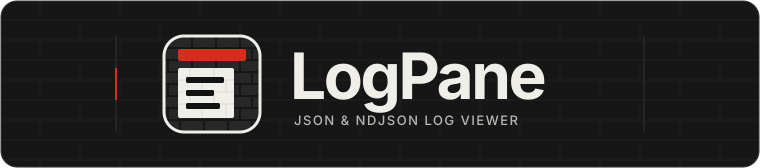
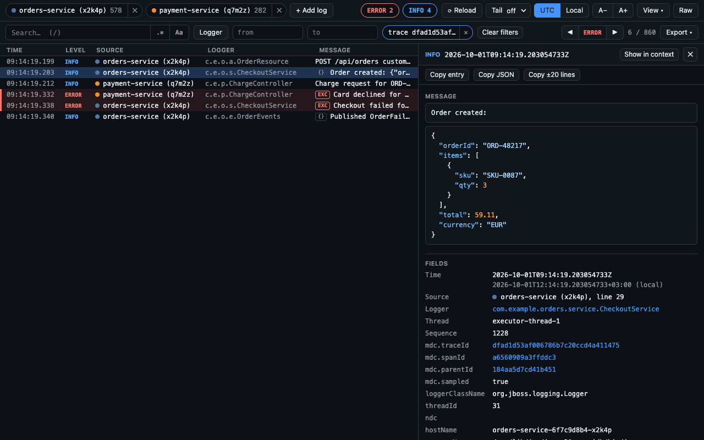
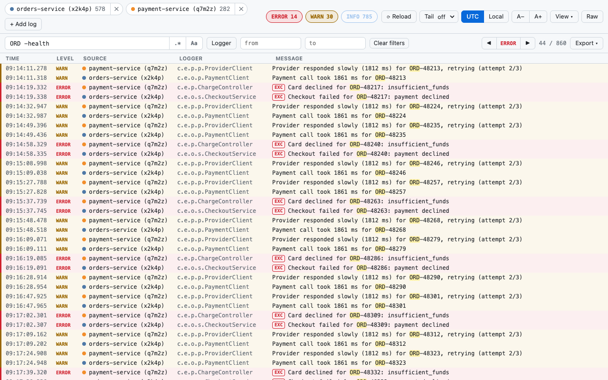
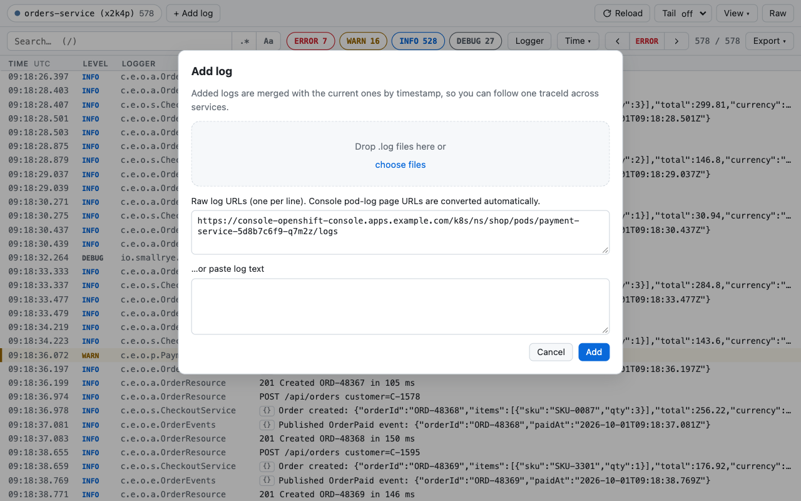
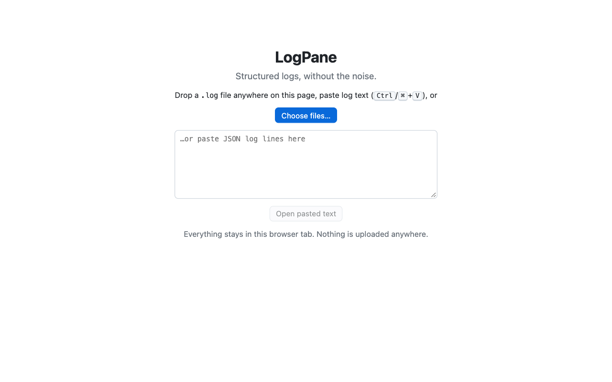

<h1 align="center">
  
</h1>

<p align="center"><strong>Structured logs, without the noise.</strong></p>

<p align="center">
  Search, filter and inspect structured logs in your browser.<br>
  One standalone HTML file for local logs. A Chrome / Edge extension for Raw log pages.
</p>

<p align="center">
  <a href="https://github.com/dovius/LogPane/releases/latest"></a>
  <a href="https://github.com/dovius/LogPane/actions/workflows/release.yml"></a>
  <a href="LICENSE"></a>
  <a href="#download"></a>
  <a href="#privacy-first"></a>
</p>

<p align="center">
  <strong><a href="https://github.com/dovius/LogPane/releases/latest/download/logpane.html">Download standalone</a></strong>
  &nbsp; · &nbsp;
  <strong><a href="https://github.com/dovius/LogPane/releases/latest/download/logpane-extension.zip">Download extension</a></strong>
</p>

<p align="center">
  <a href="#download">Install</a> ·
  <a href="#features">Features</a> ·
  <a href="#supported-formats">Formats</a> ·
  <a href="#privacy-first">Privacy</a> ·
  <a href="#keyboard-shortcuts">Shortcuts</a> ·
  <a href="#development">Development</a>
</p>


<details>
<summary>More screenshots: trace correlation, search, multiple sources and local files</summary>

| Follow a request across services | Narrow the log with search and filters |
| --- | --- |
| [](store/screenshot-2-trace-across-services.png) | [](store/screenshot-3-search-filter.png) |

| Add another log source | Open local files or paste text |
| --- | --- |
| [](store/screenshot-4-add-log.png) | [](store/screenshot-5-file-viewer.png) |

Screenshots use fictional demo logs. Select an image to view it at full size.

</details>

## Download

### Standalone: one file, no installation

Download **[`logpane.html`](https://github.com/dovius/LogPane/releases/latest/download/logpane.html)**,
open it in your browser, then drop `.log`, `.json` or `.ndjson` files onto the page, or paste log text.
The file is self-contained and has no network access. It also works where browser extensions are
blocked by policy.

### Extension: Chrome and Edge

Download **[`logpane-extension.zip`](https://github.com/dovius/LogPane/releases/latest/download/logpane-extension.zip)**,
then install it as an unpacked extension:

1. Unzip the archive.
2. Open `chrome://extensions` in Chrome or `edge://extensions` in Edge.
3. Turn on **Developer mode**, choose **Load unpacked**, and select the unzipped folder.

| Capability | Standalone HTML | Chrome / Edge extension |
| --- | --- | --- |
| Open files, drag and drop, or paste logs | Yes | Yes |
| Search, filter, inspect and export | Yes | Yes |
| Merge multiple files by timestamp | Yes | Yes |
| View a Raw log page in place | No | Yes |
| Add Raw log URLs | No | Yes, from the current log page's origin |
| Open Raw pod logs automatically | No | Yes, on domains you enable |
| Reload and Tail remote logs | No | Yes |
| Setup | Open the downloaded HTML file | Load the unpacked extension |

Find all versions and release notes on the [Releases page](https://github.com/dovius/LogPane/releases).
Each release includes [`SHA256SUMS.txt`](https://github.com/dovius/LogPane/releases/latest/download/SHA256SUMS.txt).

<details>
<summary>Verify your downloads with SHA-256</summary>

Download `logpane.html`, `logpane-extension.zip` and `SHA256SUMS.txt` from the **same release** into one
folder. Run the command for your system from that folder:

```sh
# Linux
sha256sum --check SHA256SUMS.txt

# macOS
shasum -a 256 --check SHA256SUMS.txt
```

Both files should report `OK`. If you download only one artifact, compare its SHA-256 digest with its
entry in `SHA256SUMS.txt`; the full check expects both files to be present.

</details>

## Features

### Find the relevant events

- Search messages, MDC / structured fields, and exception types and messages. Terms are ANDed;
  use `"exact phrase"`, `-exclude`, regex or case-sensitive search.
- Filter by severity, logger or time range, including the last 1 minute to 6 hours of the log.
  Click a severity chip to isolate a level; Ctrl/⌘/Shift-click toggles it. Remove active filters individually.
- Click a trace ID, correlation ID or request ID to see related entries. Merge several files or, in the
  extension's in-page viewer, Raw URLs to follow a request across services.

### Inspect the details

- Read a virtualised, level-coloured list with time, level, logger and message, plus optional thread
  and source columns.
- Open an entry to see its message with embedded JSON pretty-printed, its stack trace and grouped
  fields: trace IDs, flattened context, and host / process details. Copy or search individual values,
  move between entries with ↑ / ↓, or inspect the raw JSON.
- Read structured exceptions and plain-text Java traces in a familiar stack-trace format, with a
  cause-chain summary. Framework frames are dimmed and long runs are folded; traces can be copied
  into your IDE.

### Keep the useful context

- Copy an entry, its JSON, its stack trace or ±N surrounding lines. Export everything currently shown.
  Selected rows copy with aligned columns, or as a table when pasted into a spreadsheet.
- Choose UTC or local time, text size, and logger / thread columns from **View**. Light and dark themes
  follow your system setting.
- Use the extension's [Reload and Tail](#reload-and-tail) controls to follow Kubernetes / OpenShift
  pod logs without leaving the viewer.

## Using it

### Open a log page

In the extension, click the LogPane toolbar button on a plain-text log page, such as the Kubernetes /
OpenShift console's **Raw** pod log. Click again, or choose **Raw**, to return to the original text.
The toolbar icon is grey when inactive and lights up in colour on tabs where LogPane is open.

On other pages, the toolbar button opens the file viewer. Drop files or paste log text there, just as
in the standalone version. Use **Add log** to combine sources; URL inputs are available only in the
extension's in-page viewer and must use the current page's origin.

### Open Raw pod logs automatically

The first time you open a Raw pod log with the toolbar button, LogPane offers to open that console's
Raw logs automatically. Choose **Enable…**, confirm in the small window, and allow access in the
browser's permission prompt. You can also manage this setting under **View** or in the extension options.

After that, choosing **Raw** in the console opens the log in LogPane. The raw text stays hidden while
it downloads, so it does not flash before the viewer appears. Pages that are not JSON logs are left alone.

### Reload and Tail

The extension can refresh logs with **Reload**, or keep checking for new entries with **Tail**.
Kubernetes / OpenShift pod logs use `sinceTime`; Tail pauses in background tabs.

Some consoles reject the viewer's own requests with HTTP 401 and accept only real page loads.
On these **navigation-only** consoles, Reload refreshes the tab like F5, and Tail reloads it at
intervals of at least 10 seconds, labelled **Tail ↻**. Search, filters, selection and scroll position
are kept across those reloads.

## Supported formats

| Format | Notes |
| --- | --- |
| Quarkus / JBoss JSON logging | MDC and structured exceptions, including `frames`, `causedBy` and `suppressed` |
| logstash-logback-encoder | Common with Spring Boot / Logback; supports `stack_trace` strings |
| Elastic ECS | Structured log fields |
| GELF | Including Spring Boot structured logging |
| pino, bunyan, winston | Node.js logging |
| Docker `json-file` | Unwraps the inner JSON line |
| `<timestamp> {json}` | For example, `kubectl logs --timestamps` |

Plain-text and broken lines are kept as-is. Java stack-trace continuation lines are grouped with
their entry, and timestamps retain nanosecond precision for ordering.

## Privacy first

LogPane parses logs in the current browser tab. There is no LogPane backend, account, analytics or
telemetry, and log content is not uploaded.

| Area | What happens |
| --- | --- |
| Standalone networking | The self-contained HTML file has no network access; its CSP uses `default-src 'none'`. |
| Extension networking | The in-page viewer can fetch logs from the same website for **Add log** URLs, **Reload** and **Tail**, using your existing browser session. The file viewer and options page block network requests with `connect-src 'none'`. |
| Permissions | `activeTab` grants access when you click the toolbar button. Automatic opening requires permission for each domain you enable: one `https://` domain at a time, or `localhost`. |
| Storage | Logs stay in memory, not persistent storage. Display settings and auto-open preferences are saved. Navigation-only reloads briefly retain the current view in tab-scoped, in-memory session storage. |
| Untrusted input | Log text is never treated as markup. Control characters are displayed visibly and escaped on export; parsing, search and rendering have bounds for hostile input. |

Read the [privacy policy](PRIVACY.md) and [security protections](SECURITY.md#how-logpane-protects-you).
For vulnerabilities, follow the [private reporting instructions](SECURITY.md#reporting-a-vulnerability)
rather than opening a public issue.

## Keyboard shortcuts

| Key | Action |
| --- | --- |
| `/` | Focus search |
| `↑` / `↓` or `j` / `k` | Move between entries |
| `n` / `N` | Next / previous error |
| `w` / `W` | Next / previous warning |
| `g` / `G` | Top / bottom |
| `c` | Copy entry |
| `Esc` | Close / clear |

## Development

### Install from source

Requires **Node 20+**.

```sh
npm ci
npm run build      # → dist/ (unpacked extension) and dist/standalone/logpane.html
```

Load `dist/` with **Load unpacked** in `chrome://extensions` or `edge://extensions` with Developer mode
on. For the standalone viewer, open `dist/standalone/logpane.html` directly.

<details>
<summary>Development commands, tests and project structure</summary>

```sh
npm run preview                # build, then open LogPane with demo logs in a separate Chromium window
npm run watch                  # rebuild on change
npm test                       # unit + edge-case tests (vitest)
npm run test:e2e               # end-to-end tests in a real Chromium with the extension loaded
npm run test:all               # typecheck + unit + end-to-end
npm run typecheck
npm run zip                    # → logpane-extension.zip (also suitable for a Chrome Web Store upload)
node scripts/dev-server.mjs some.log [more.log] [--port 8080] [--grow] [--navigation-only]
```

The dev server serves files like the Kubernetes Raw log endpoint, at
`http://localhost:8080/api/kubernetes/api/v1/namespaces/demo/pods/<file-name>/log`. It supports
`sinceTime`. `--grow` keeps appending lines so you can try Tail, and `--navigation-only` answers the
viewer's own requests with 401, like consoles that only accept page loads.

### Tests

- **Unit tests** (`test/*.test.ts`, `test/edge/`): parser, fields, time, filters, merge, stack traces,
  sources, tail and export, including seeded fuzz and property tests.
- **End-to-end tests** (`test/e2e/*.e2e.ts`): user scenarios in Chromium with the built extension.
  Coverage includes Raw pages; every log format; search, filters and keyboard; details, copy and
  export; multiple logs; automatic opening and options; Reload and Tail on normal and navigation-only
  consoles; file input, drag and drop and paste; hostile content (XSS, prototype keys and huge lines);
  themes and small screens; and a 30 MB performance budget on a 4× slower CPU. Each suite also fails
  on any page error.
- **Mock logs** (`test/support/mocklogs.ts`): deterministic generators for realistic services, every
  format and edge cases. No real data.

End-to-end tests need Chromium. They use the newest one in the Playwright cache
(`npx playwright-core install chromium`), or you can set `LOGPANE_CHROME`. Set `LOGPANE_SKIP_BUILD=1`
to reuse an existing `dist/`.

Test and demo data are fictional:

- `node scripts/make-fixtures.mjs` regenerates test fixtures; `--big 50000 <out>` creates a large file.
- `node scripts/make-demo.mjs <dir>` creates two services sharing trace IDs.
- To check a real log without committing it: `LV_REAL_LOG=/path/to/pod.log npm test`.

### Project structure

The bundles are intentionally not minified, so they are easy to review.

```text
src/core/     parsing, field aliases, time, filters, merge, stack traces, tail (pure TS, unit-tested)
src/ui/       Preact UI, store, CSS
src/entries/  content script, background service worker, options page, standalone page
static/       manifest, HTML pages, icons
store/        Chrome Web Store texts and graphics
docs/assets/  README branding
scripts/      dev server, fixture / demo / icon generators
.github/      release workflow (a GitHub release for every version tag)
```

</details>

## Releasing

The [Release workflow](.github/workflows/release.yml) runs **only on `v*` tag pushes**, not on branch
pushes or pull requests. It runs typecheck and unit tests, **not end-to-end tests**.

<details>
<summary>Maintainer release checklist and published artifacts</summary>

`package.json` holds the version; the build copies it into `manifest.json` and the standalone file.

1. Run `npm run test:all` locally, including the end-to-end tests.
2. Run `npm version patch` (or `minor` / `major`). This bumps the version, commits, and creates `vX.Y.Z`.
3. Run `git push --follow-tags`.

The tag-triggered workflow checks that the tag matches `package.json`, runs typecheck and unit tests,
builds, and publishes a GitHub release with:

- `logpane.html`, the standalone viewer;
- `logpane-extension.zip`, the extension;
- `SHA256SUMS.txt`, checksums for both artifacts.

Release notes list commit subjects since the previous tag. A suffix such as `v1.2.0-beta.1` creates
a pre-release, which the `latest/download` links skip. If the workflow fails, fix the cause and re-run
it from the Actions tab. A re-run replaces the files of an existing release while keeping its release notes.

For a Chrome Web Store submission, upload the release's `logpane-extension.zip` in the developer
dashboard. The store checks the manifest version, which must increase with every upload. Tags let
anyone identify the source used for a given version.

</details>

## License

[MIT](LICENSE). Bundled third-party code: Preact (MIT); see `THIRD_PARTY_LICENSES.txt` in the build.

## Trademarks

<details>
<summary>Third-party names and project independence</summary>

Kubernetes is a registered trademark of The Linux Foundation. Red Hat and OpenShift are trademarks
of Red Hat, Inc. Docker is a trademark of Docker, Inc. Java is a registered trademark of Oracle and/or
its affiliates. Spring Boot is a trademark of Broadcom Inc. Quarkus is a trademark of Red Hat, Inc.
Node.js is a trademark of the OpenJS Foundation. Chrome is a trademark of Google LLC. Other names
may be trademarks of their respective owners. LogPane is an independent open-source project and is
not affiliated with, endorsed by, or sponsored by any of them.

</details>
