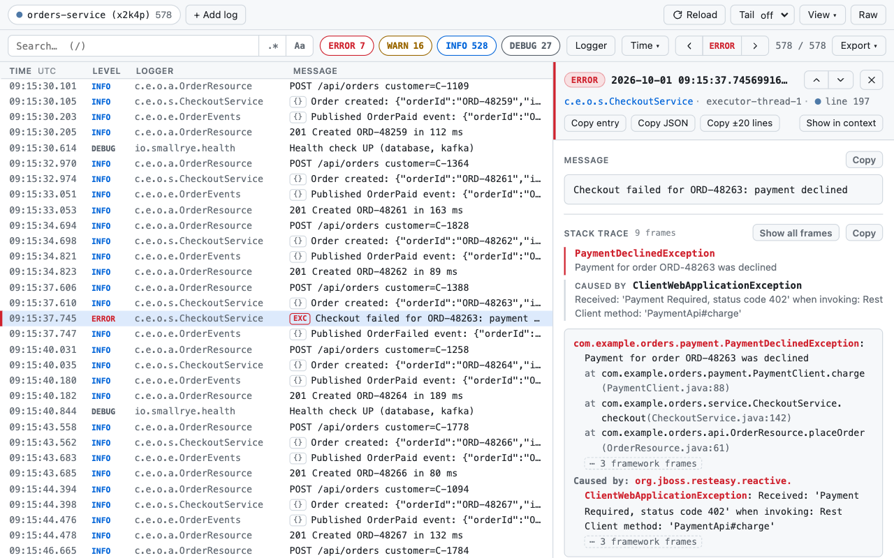

# LogPane – JSON & NDJSON Log Viewer

**Structured logs, without the noise.**

LogPane is a Chrome / Edge extension that turns raw JSON and NDJSON logs into a clean, searchable,
easy-to-read interface, directly in your browser. Open it on a log page (for example the Kubernetes /
OpenShift console's **Raw** pod log), drop in a downloaded `.log` file, or paste log text.



## Privacy first

- **100% local processing.** Logs are parsed in the browser tab and never sent anywhere. There is no backend.
- **Minimal permissions.** LogPane uses `activeTab`: it only sees a page when you click its button. Access to a domain is requested only if you enable automatic opening there (one `https://` domain at a time, or `localhost`).
- **No persistent log storage.** Logs live in memory while the tab is open. Only UI settings are saved.
- **No tracking.** No analytics, no telemetry SDKs, no accounts.
- **Enforced by the browser, not just promised.** Extension pages run with `connect-src 'none'`, and the standalone file with `default-src 'none'`, so they cannot make network requests at all.

Details: [PRIVACY.md](PRIVACY.md).

## Features

- **Readable list**: time, level, logger, message, plus optional thread and source columns. Level-coloured rows. Virtualised, so 50,000+ lines scroll smoothly.
- **Search**: terms are ANDed, `"exact phrase"`, `-exclude`. Regex and case-sensitive toggles are available. Search covers messages, MDC / structured fields, and exception types and messages.
- **Filters**: severity chips (click shows only that level, Ctrl/⌘/Shift-click toggles), logger picker, and a time range (from / to, or the last 1 min … 6 hours of the log). When nothing matches, each active filter can be removed on its own.
- **Related events**: click a trace ID, correlation ID or request ID to see every entry of that request.
- **Details panel**: the message (JSON inside it pretty-printed), the stack trace, then the fields grouped into trace IDs, context (nested objects flattened) and host / process. Values can be copied or searched one by one; ↑ / ↓ move to the neighbouring entry. The raw JSON is one click away.
- **Stack traces**: structured exceptions (Quarkus `frames` / `causedBy` / `suppressed`), `stack_trace` strings and plain-text Java traces are shown as normal Java stack traces you can paste into the IDE, with a summary of the cause chain. Framework frames are dimmed and long runs of them folded.
- **Several logs at once**: add files or Raw URLs, merged by timestamp, so you can follow one trace across services.
- **Safe with untrusted logs**: log text is never treated as markup, crafted lines can't freeze or break the viewer, and control characters are shown and escaped. See [SECURITY.md](SECURITY.md#how-logpane-protects-you).
- **Reload and live tail** for Kubernetes / OpenShift pod logs (uses `sinceTime`, pauses in background tabs).
  Some consoles answer the viewer's own requests with 401 and accept only real page loads. There, Reload reloads the tab like F5, and Tail reloads it every ≥ 10 s (shown as **Tail ↻**). Search, filters, selection and scroll position are kept across reloads.
- **Copy / export**: an entry, its JSON, its stack trace, ±N lines of context, or everything currently shown.
- **Display options** (View menu): UTC or local time, text size, logger and thread columns. Dark and light themes follow the system.
- **Keyboard**:

  | Key | Action |
  | --- | --- |
  | `/` | search |
  | `↑` `↓` or `j` `k` | move |
  | `n` / `N` | next / previous error |
  | `w` / `W` | next / previous warning |
  | `g` / `G` | top / bottom |
  | `c` | copy entry |
  | `Esc` | close / clear |

### Supported formats

| Format | Notes |
| --- | --- |
| Quarkus / JBoss JSON logging | Structured exceptions, MDC |
| logstash-logback-encoder | Common for Spring Boot / Logback |
| Elastic ECS | |
| GELF | Spring Boot structured logging |
| pino, bunyan, winston | Node.js |
| Docker `json-file` | The inner JSON line is unwrapped |
| `<timestamp> {json}` | e.g. `kubectl logs --timestamps` |

Plain-text and broken lines are kept as-is, and Java stack-trace continuation lines are grouped with
their entry. Timestamps keep full nanosecond precision for ordering.

## Using it

- **On a log page**: click the LogPane toolbar button on any plain-text log page. Click again, or use **Raw**, to switch back to the original text.
- **Open automatically**: the first time you open a Raw pod log with the toolbar button, LogPane offers to open that console's Raw logs automatically. Click **Enable…**, confirm in the small window, and allow access in Chrome's prompt. The setting is also under View ▾ and in the extension options. From then on, clicking **Raw** in the console opens the log straight in LogPane. The raw text never flashes: it stays hidden while it downloads, and pages that are not JSON logs are left alone.
- **Local files**: click the toolbar button on any other page, then drop `.log` / `.json` / `.ndjson` files or paste text.
- **Without installing anything**: `dist/standalone/logpane.html` is one self-contained HTML file. Open it from disk and drop a log on it. This works where extensions are blocked by policy.

## Install from source

Requires Node 20+.

```sh
npm ci
npm run build      # → dist/  (unpacked extension) and dist/standalone/logpane.html
```

Then go to `chrome://extensions` (Edge: `edge://extensions`), enable **Developer mode**, click
**Load unpacked**, and select `dist/`.

## Releasing

`package.json` holds the version; the build copies it into `manifest.json`.

1. `npm version patch` (or `minor` / `major`). This bumps the version, commits, and creates the tag `vX.Y.Z`.
2. `npm ci && npm test && npm run zip` produces `logpane-extension.zip`.
3. `git push --follow-tags`.
4. Upload the zip in the Chrome Web Store dashboard. Optionally attach it to a GitHub release for that tag.

The Chrome Web Store only looks at the manifest version, which must increase with every upload. The tags let anyone check which source a store version was built from.

## Development

```sh
npm run preview                # build, then open LogPane with demo logs in a separate Chromium window
npm run watch                  # rebuild on change
npm test                       # unit + edge-case tests (vitest)
npm run test:e2e               # end-to-end tests in a real Chromium with the extension loaded
npm run test:all               # typecheck + unit + end-to-end
npm run typecheck
npm run zip                    # → logpane-extension.zip for the Chrome Web Store
node scripts/dev-server.mjs some.log [more.log] [--port 8080] [--grow] [--navigation-only]
```

The dev server serves files like the Kubernetes Raw log endpoint, at
`http://localhost:8080/api/kubernetes/api/v1/namespaces/demo/pods/<file-name>/log`. It supports
`sinceTime`. `--grow` keeps appending lines so you can try Tail, and `--navigation-only` answers the
viewer's own requests with 401, like consoles that only accept page loads.

### Tests

- **Unit tests** (`test/*.test.ts`, `test/edge/`): parser, fields, time, filters, merge, stack traces, sources, tail and export. Includes seeded fuzz and property tests.
- **End-to-end tests** (`test/e2e/*.e2e.ts`): user scenarios in Chromium with the built extension.
  - opening Raw pages
  - every log format
  - search, filters and keyboard
  - details, copy and export
  - several logs at once
  - automatic opening and options
  - Reload and Tail, on normal and on "navigation-only" consoles
  - the file viewer (files, drag & drop, paste)
  - hostile content (XSS, prototype keys, huge lines)
  - themes and small screens
  - a 30 MB performance budget on a 4× slower CPU

  Each suite also fails on any page error. The tests need a Chromium: they use the newest one in the Playwright cache (`npx playwright-core install chromium`), or set `LOGPANE_CHROME`. Set `LOGPANE_SKIP_BUILD=1` to reuse an existing `dist/`.
- **Mock logs** (`test/support/mocklogs.ts`): deterministic generators for realistic services, every format and edge cases. No real data.

Test and demo data are fictional:
- `node scripts/make-fixtures.mjs` regenerates the test fixtures, and `--big 50000 <out>` creates a large file.
- `node scripts/make-demo.mjs <dir>` creates two services sharing trace IDs.
- To check a real log without committing it: `LV_REAL_LOG=/path/to/pod.log npm test`.

The bundles are intentionally not minified, so they are easy to review.

```
src/core/     parsing, field aliases, time, filters, merge, stack traces, tail (pure TS, unit-tested)
src/ui/       Preact UI, store, CSS
src/entries/  content script, background service worker, options page, standalone page
static/       manifest, HTML pages, icons
store/        Chrome Web Store texts and graphics
scripts/      dev server, fixture / demo / icon generators
```

## License

[MIT](LICENSE). Bundled third-party code: Preact (MIT), see `THIRD_PARTY_LICENSES.txt` in the build.

## Trademarks

Kubernetes is a registered trademark of The Linux Foundation. Red Hat and OpenShift are trademarks of Red Hat, Inc. Docker is a trademark of Docker, Inc. Java is a registered trademark of Oracle and/or its affiliates. Spring Boot is a trademark of Broadcom Inc. Quarkus is a trademark of Red Hat, Inc. Node.js is a trademark of the OpenJS Foundation. Chrome is a trademark of Google LLC. Other names may be trademarks of their respective owners. LogPane is an independent open-source project and is not affiliated with, endorsed by, or sponsored by any of them.
